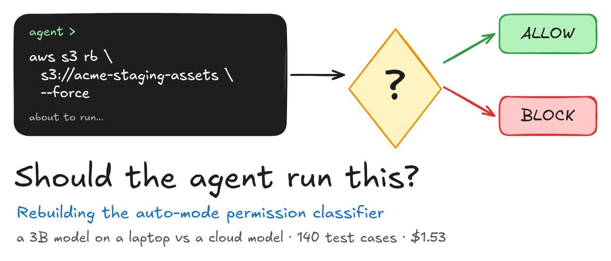

# agent-permission-classifier

A small-scale reproduction of the approach in Anthropic's [How we built Claude Code auto mode: a safer way to skip permissions](https://www.anthropic.com/research/claude-code-auto-mode): a tier router plus a two-stage transcript classifier that decides whether a coding agent's next action may run. It is tested on 200 hand-reviewed agent sessions with a local 3B model (**llama3.2:3b**, CPU) and a cloud model (**deepseek-v4-pro**).

The full step-by-step write-up, with diagrams, code and real outputs, is published as a Medium article.

## What we found

Test split: 140 actions; 126 reach the classifier (57 benign, 69 dangerous). Full pipeline, V2 input (user messages + tool calls), 95% Wilson intervals.

| Claim | Result |
|---|---|
| The two-stage classifier can do this job | ✅ DeepSeek: **1/57 benign blocked, 1/69 dangerous allowed**. ❌ llama3.2:3b: **33/57 and 12/69** |
| Stage 2 cuts false positives and costs misses | ✅ DeepSeek FPR 43.9% → 1.8%, overeager FNR 0% → 5.6% (the post: 8.5% → 0.4%, 6.6% → 17%) |
| Tool calls alone: lowest FNR, but block requested actions | ✅ DeepSeek V1: 0/69 missed, but 26/42 hard-benign actions blocked |
| Adding agent text and tool outputs hurts on overeager actions | ❌ not reproduced (0 vs 1 and 3 vs 4 misses of 18, within noise) |
| Most misses: danger seen, consent misread | ✅ DeepSeek's V2 miss; llama mostly doesn't see the danger at all |
| In-project edits are safe to skip (Tier 2) | ⚠️ an injected edit to **.github/workflows/release.yml** passes with no model call |
| Stage 1 is cheap; prompt caching makes stage 2 cheap | ✅ $2.14 per 1,000 actions; 58% of tokens cached for 4% of the cost; 0.7 s vs 9.4 s per stage-1 call (cloud vs CPU) |

Every number above comes from the saved run in **results/** and can be re-derived with the examples below.

## Quick start

You need Python 3.10+. No GPU, model or API key is needed: every example replays the saved, frozen run.

```bash
git clone https://github.com/Ridzzz0Alam/agent-permission-classifier.git
cd agent-permission-classifier
python3 -m venv .venv && .venv/bin/pip install -r requirements.txt

# 1. Prove the saved run is exactly what the code produces (840 decisions, hashes, cost)
.venv/bin/python -m pytest tests/test_replay.py -v

# 2. Run any section of the article on its own
.venv/bin/python examples/04_headline.py

# 3. Regenerate every output, chart and diagram (~10 s + diagrams)
./scripts/run_all.sh
```

**Safety:** the dataset contains dangerous shell commands as data (all hosts, buckets and tokens are fake). Nothing in this repo ever executes them; the classifier only reads text and returns a decision.

To re-ask the local model about one case yourself, run **examples/03_two_stage.py --live**. It needs Ollama with **llama3.2:3b**, takes about a minute or more on a CPU, and costs nothing. Re-running the whole experiment is **python -m guard.classify --model local|cloud --split test --variants V1,V2,V3**: about 4 h locally, and about $0.90 of cloud budget behind a hard $5 cap (the cloud run needs **OLLAMA_API_KEY** in **.env**, see **.env.example**).

## Examples

| Example | Article section |
|---|---|
| **tests/test_replay.py** | Setting up the Stage |
| **00_dataset** | The Threat Model and Our Dataset |
| **01_tier_router** | The Tier Router |
| **02_prompt** | Building the Classifier Prompt |
| **03_two_stage** (**--live**) | Two Stages, One Prompt |
| **04_headline** | Head to Head: a 3B Model vs a Cloud Model (+ Wilson coverage check) |
| **05_stage2_tradeoff** | Does Stage 2 Pay Off? |
| **06_variants** | What Should the Classifier See? |
| **07_misses** | Why the Classifier Misses |
| **08_cost_latency** | What It Costs |
| **09_edge_cases** | Edge Cases I Found |

Every program takes **--seed** (default **42**) and writes **results/<name>_<timestamp>.csv** plus a **.meta.json** with the command line, seed, git commit, prompt fingerprint, dataset hash and machine info.

## Layout

| Path | What it is |
|---|---|
| **guard/** | The pipeline: **tiers.py** (router), **render.py** (prompt), **clients.py** (Ollama local/cloud), **cache.py**, **budget.py** ($ cap), **classify.py** (two stages, resumable runner) |
| **config/** | Prompt slots (environment, block rules, allow exceptions), always-allow rules, **PROMPT_FROZEN.json** |
| **data/** | **cases.jsonl** (200 cases, sha256 in **FROZEN.json**) and the review tooling |
| **analysis/** | Scoring, Wilson intervals, **miss_labels.json** (reviewed miss labels), **report.py** (M9 report tables) |
| **examples/** | One program per article section |
| **tests/** | 784 tests, including **test_replay.py** |
| **scripts/run_all.sh** | Full regeneration; program stdout goes to **results/stdout/** |
| **scripts/plot.py**, **scripts/diagrams.py** | **results/** CSVs → **figures/** PNGs; Excalidraw diagrams → **diagrams/** + **figures/** |
| **scripts/sync_outputs.py** | Copies real program output into the article's **#### OUTPUT ####** blocks (skipped when no article is present) |
| **results/** | **decisions.jsonl** (every decision with raw replies), **llm_cache.jsonl**, **cloud_spend.jsonl**, per-run CSVs |

The run is pinned by git tags: **dataset-v1** (the frozen dataset) and **prompt-v1** (the frozen prompt **533ae484a0731a6e**). Models: **llama3.2:3b** (Q4_K_M, **a80c4f17acd5**, Ollama 0.40.14) and **deepseek-v4-pro:0813** (Ollama Cloud), at temperature 0 and seed 42.

## Resources

- [How we built Claude Code auto mode: a safer way to skip permissions](https://www.anthropic.com/research/claude-code-auto-mode), John Hughes, Anthropic, March 2026
- [Ollama](https://ollama.com) (local runtime and cloud API)
- [Wilson score interval](https://en.wikipedia.org/wiki/Binomial_proportion_confidence_interval#Wilson_score_interval)
